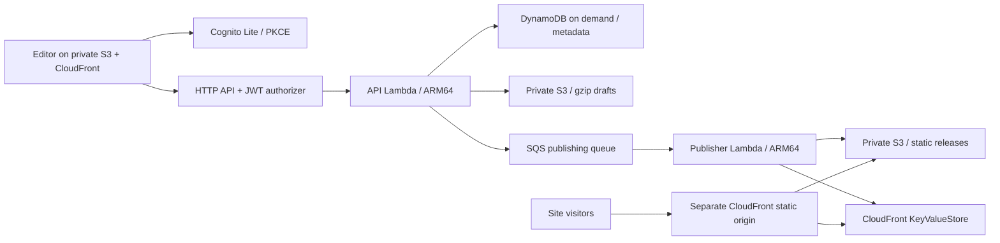

# CI and optional AWS deployment

The application is implemented and exercised locally. No AWS account is required, and no cloud resources are created by local setup, development, tests, builds, or CI. The AWS template and deployment workflow are prepared separately; they still need an account-specific IAM/bootstrap review and a real staging deployment before being treated as production-verified.

The new local commerce/account work also introduces a mandatory release gate in `release-readiness.json`. Both direct deployment and the GitHub deployment workflow stop while any requirement is unverified. Use `npm run release:readiness` to inspect it. The existing AWS templates do not yet constitute a production deployment of the new commerce surface.

## Development to a published preview

1. `npm ci`, `npm run local:setup`, `npm run dev:local`.
2. Create a local account; save a site, edit it, then publish from Workspace.
3. Visit its local URL. Make another edit, publish, restore an earlier release, and unpublish.
4. Run `npm run check` and, with the backend running, `npm run test:integration`.
5. Push the app repository to GitHub. `.github/workflows/ci.yml` runs on PRs and `develop`, `main`, and `master`. It performs type checks, UI/service tests, build, dependency audit, CloudFormation schema checks, and the complete workflow against a fresh DynamoDB Local instance. It stores the tested build artifact for three days. Superseded runs are cancelled.

This checkout is a single repository with `package.json` at its root, matching the remote. Workflows live in `.github/` and use root paths. No commit or push is performed by setup.

## Architecture prepared for AWS



The editor and sites use separate HTTPS origins. Visitors never call the API, Lambda, or DynamoDB. CloudFront rewrites canonical paths to immutable release paths using a small key/value lookup. A complete release is promoted in one pointer update; propagation is eventual across edge locations. HTML refers to release-specific assets. Viewer headers require revalidation to avoid browsers pinning a stable URL to an old release, while S3 immutable headers let the edge cache release objects.

## Cost controls

| Control                                                                             | Effect                                                                                                     |
| ----------------------------------------------------------------------------------- | ---------------------------------------------------------------------------------------------------------- |
| DynamoDB `PAY_PER_REQUEST`; no indexes or production scans                          | Metadata requests and storage only; no provisioned database capacity                                       |
| S3 gzip drafts; metadata outside project blobs                                      | Small DynamoDB items, compressed transfer/storage; 3 MB compressed request limit                           |
| Ten-second debounce + content hash + no-op publish detection                        | No writes for every keystroke, unchanged content, or duplicate builds                                      |
| Lambda + SQS; ARM64; bounded uploads; concurrency 2 for publishing                  | No server/container running while idle; retry/DLQ rather than endless retries                              |
| Private S3 + CloudFront for sites                                                   | No application compute/database calls per visitor                                                          |
| Versioned releases + route pointer                                                  | No site-publish CDN invalidations; rollback reuses files                                                   |
| Last three releases, seven-day logs, three-day CI artifacts                         | Bounded normal history rather than unlimited accumulation                                                  |
| API 5 requests/sec, burst 10; DynamoDB max 50 read / 25 write units/sec             | Initial throughput guardrails (raise for actual demand)                                                    |
| Cognito Lite, invitation-only in the initial AWS template                           | MAU usage pricing; controlled account onboarding                                                           |
| Existing DNS + standard CloudFront, non-exportable ACM certificates, SSE-S3, no VPC | No default domain/DNS, NAT gateway, ALB, dedicated key, database instance, or provisioned-concurrency fees |

There is **no fixed compute/capacity charge** in this design. There can still be a charge while nobody is editing: retained bytes are storage usage. Monthly cost depends on stored GB, reads/writes, Lambda requests and GB-seconds, SQS operations, Cognito active users, CloudFront requests/function/KVS operations, and data delivery. GitHub runner minutes and artifact storage have separate plan quotas. Rate limits and retention are not a hard spending cap. Do not use a CloudFront flat-rate plan for this stack.

Use the actual region and workload in the AWS calculator before enabling a deployment. Current primary references: [DynamoDB on-demand pricing](https://aws.amazon.com/dynamodb/pricing/), [Lambda pricing](https://aws.amazon.com/lambda/pricing/), [Cognito tiers](https://aws.amazon.com/cognito/pricing/), [S3 pricing](https://aws.amazon.com/s3/pricing/), [CloudFront pricing](https://aws.amazon.com/cloudfront/pricing/), [SQS pricing](https://aws.amazon.com/sqs/pricing/). No free-tier assumptions or zero-bill promise are embedded in the code.

## Bootstrap a development environment

The default CI has no AWS credentials. `infra/bootstrap.mjs` creates a private artifact bucket, a GitHub OIDC provider (or reuses the account's provider), a deployment role, and a separate CloudFormation execution role. These are account infrastructure, so first choose the actual account/region and review `.build/bootstrap.json`. CloudFront, Cognito and API Gateway assign IDs at creation; some deployment-role permissions cover those service resources within the account rather than one generated ID. Runtime roles are separate. No AdministratorAccess policy is attached.

Use AWS CLI v2 with an authorized session and GitHub CLI if configuring environment variables automatically. The scripts never embed credentials. An example configuration (replace the account/repository values):

```sh
export AWS_REGION=us-east-1
export AWS_ACCOUNT_ID=YOUR_12_DIGIT_ACCOUNT_ID
export FORMA_STACK=forma-development
export FORMA_ENVIRONMENT=development
export GITHUB_REPOSITORY=OWNER/REPOSITORY
npm run aws:bootstrap                         # generate only
npm run aws:bootstrap -- --apply              # create the reviewed bootstrap
npm run aws:bootstrap -- --apply --configure-github
```

Create the GitHub `development` and `production` environments before configuring their variables. Restrict production to your release branch and configure its reviewer rules. Use separate stacks (`forma-development`, `forma-production`), preferably separate accounts; repeat bootstrap for each. The account guard fails if the active AWS identity differs from `AWS_ACCOUNT_ID`.

GitHub repositories created after July 15, 2026, or opted into immutable subjects, include owner/repository IDs in their OIDC subject. For those, set `GITHUB_OIDC_SUBJECT=repo:OWNER@OWNER_ID/REPOSITORY@REPOSITORY_ID:environment:development` (or `production`) before bootstrap. Otherwise the default is `repo:OWNER/REPOSITORY:environment:development`. The script accepts only the exact repository/environment, without wildcard trust. Check the repository's actual subject format using [GitHub's OIDC guidance](https://docs.github.com/en/actions/how-tos/secure-your-work/security-harden-deployments/oidc-in-aws). Do not broaden the trust to work around a mismatch.

Bootstrap writes `.build/github-environment.json`. It can set the following identifiers with `--configure-github`; they are environment variables, not credential secrets:

| Variable                                   | Purpose                                                                   |
| ------------------------------------------ | ------------------------------------------------------------------------- |
| `AWS_ACCOUNT_ID`                           | Intended account, checked against the authenticated caller                |
| `AWS_REGION`                               | Region for the app's database, functions and storage                      |
| `FORMA_STACK`                              | Environment-specific `forma-*` stack                                      |
| `ARTIFACT_BUCKET`                          | Private bucket created by bootstrap                                       |
| `AWS_DEPLOY_ROLE`                          | Exact repository/environment OIDC role ARN                                |
| `CF_EXECUTION_ROLE`                        | CloudFormation execution role ARN                                         |
| `EDITOR_DOMAIN` / `EDITOR_CERTIFICATE_ARN` | Optional paired hostname + issued us-east-1 certificate; see domain guide |

## Development → production → owned domain

1. Commit the app repository, including its workflows, and push a reviewed revision.
2. Set repository variable `AWS_DEPLOY_ENABLED=true` only once the environments and roles are configured. A push to `develop` runs checks and deploys to **development**. You can also manually run **Development to production (opt in)** with environment `development` and confirmation `DEPLOY`. Leave the editor-domain variables empty for the initial distribution.
3. The workflow repeats type/lint/UI/unit/build/security checks, validates all four infrastructure templates, and exercises accounts, domains and publication against a fresh DynamoDB Local instance **before** exchanging its OIDC token. It uploads the app, waits for the editor CDN, and checks public pages, API health, and unauthenticated denial. Its `deployment-…` artifact contains `.build/deployment.json`, including the HTTPS editor URL, CloudFront DNS target and Cognito pool.
4. Invite a test user into that Cognito pool, complete hosted sign-in, and publish a test website. Local accounts are not migrated. Verify a second tenant is denied, gzip draft transport/CORS, queue retry/DLQ recovery, propagation and rollback in development; local tests cannot prove live IAM and edge behavior.
5. Connect the platform's own hostname using [the domain guide](domains.md#the-forma-platforms-own-domain). Connect customer/site hostnames in the app through **Domains & publish**. Keep editor and customer hostnames distinct.
6. Bootstrap/configure **production**, then manually dispatch the workflow on the reviewed release branch with environment `production` and `DEPLOY`. Production uses its own database, users, buckets and domain connections. CI does not silently copy development accounts or content into production.

The deployment script requires AWS CLI v2, verifies the target account, packages the Lambda artifact, validates/deploys CloudFormation, rebuilds metadata using the actual editor origin, writes non-secret runtime configuration, and uploads immutable assets before entrypoint HTML. It refreshes the editor with one `/*` invalidation path; website publishing changes only its route pointer. HTML is `no-cache`, runtime configuration `no-store`; robots/sitemap retain their proper content types. CDN/public-page health failures fail the deployment job instead of reporting success.

The initial Cognito pool is invitation-only. Create invited users in the output pool through AWS's console or CLI. If you want public registration, change `AdminCreateUserConfig`, configure production email delivery/rate controls, and test in development first. The deployment files are implemented and locally validated; a real AWS run and its account-specific verification remain required before calling an environment live.

## Rollback and operations

- **Website content:** Restore release in Workspace. It changes only the public route, preserving the current draft. Unpublish takes the route offline.
- **Application code:** Dispatch the deployment workflow on a previously tested commit. It rebuilds and uploads that version; old editor assets are retained so open tabs continue working. Review schema changes before rollback.
- **Failed publish:** Existing complete releases stay available. After repeated/transient failures inspect the output DLQ and publisher log. Stale locks expire after ten minutes. A subsequent publish uses a new job ID; stale deliveries cannot promote over it.
- **Data durability:** Table, user pool, and data buckets use `Retain` on stack deletion/replacement. Deleting a stack therefore does not delete your sites, accounts, or retained-storage charges. Backup/PITR, longer logs, public signup protections and monitoring can be added deliberately for production; they are not silently enabled at extra cost.
- **Orphan storage:** Old-draft/release cleanup is best effort; inspect failed jobs and cleanup warnings. Do not apply a blanket object-expiration rule to all published files—it could delete an active website. Old editor build assets and abandoned Lambda artifacts need periodic reviewed cleanup.

### Branded pages

The build prerenders the public product pages to directory `index.html` files. An editor-only CloudFront Function rewrites extensionless paths to those files; assets pass through, and missing pages use `404.html` with HTTP 404. These pages use S3/CloudFront, without Lambda rendering or DynamoDB reads. Workspace pages load account data only when opened. HTML uploads use `no-cache`, runtime config uses `no-store`, and static assets upload before HTML. Website publishing still never invalidates the CDN.

For standalone local builds, optional `PUBLIC_SITE_URL` supplies an HTTPS origin for canonical links and the sitemap. The deployment script overrides it with the actual stack output, including the configured editor domain. No placeholder domain is emitted.
